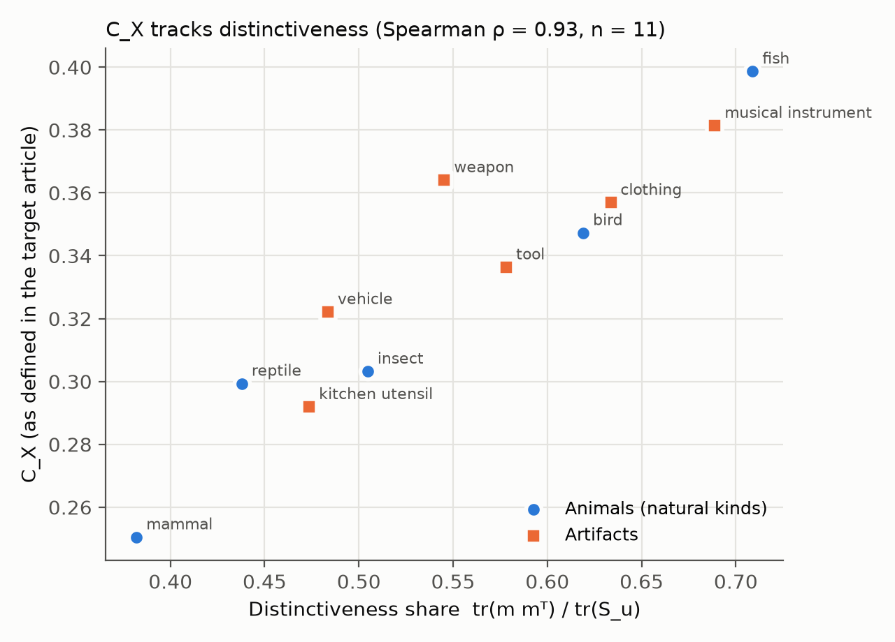

# What does C_X measure?

Code, manuscripts, results and figures for an empirical examination of the
PCA account of conceptual coherence proposed by Osta-Vélez and Gärdenfors
(2026), with additional Sentence-BERT comparisons.

**Author:** David Vesterlund · WestQuant Open, Vesterlund Ventures Holding AB

**Start here:** [English manuscript](manuscript.md) ·
[SBERT comparison report, Swedish](sbert/REPORT.md) ·
[Original norm-data report, Swedish](sbert/reference/normdata_report.md)

The target article defines C_X but does not report numerical results on these
datasets. The empirical analyses here are an independent examination of its
measure, not results or software released by the target article's authors.

## Research question

Does C_X measure covariation within a category, or its distinctiveness from
the reference prototype? For salience-weighted exemplars, the matrix used by
the measure decomposes as

```math
S_u = \mathrm{Cov}_s(X) + m m^\top,
\qquad m = s \odot (\bar{x} - u).
```

The second term can concentrate variance on a single axis even when the
category's features have little internal covariation. The analyses compare
these components with human similarity and typicality judgments, natural
kind versus artifact categories, and size-matched random groups.

## Material included

| Location | Contents |
| --- | --- |
| [`manuscript.md`](manuscript.md) | English comment, with linked figures and the repository URL |
| [`norms/`](norms/) | Complete expanded second analysis archive: Leuven/McRae code and tables, MiniLM/BGE embedding code and supplied summary results, original README, and regenerated figures |
| [`sbert/`](sbert/) | Additional `all-mpnet-base-v2` comparison: code, report, environment lock, cached embeddings, figures, and predictions for every exemplar and pair |
| [`sbert/upstream/`](sbert/upstream/) | Complete expanded first analysis archive |
| [`sbert/reference/`](sbert/reference/) | Original Swedish report, target-article PDF and extracted text |
| [`materials/`](materials/) | Both original ZIP archives and the unmodified English manuscript |
| [`PROVENANCE.md`](PROVENANCE.md) | Source inventory, verification scope and differences between analysis pipelines |

Model weights, Python environments and downloaded raw norm datasets are not
stored in Git. The two MPNet embedding caches are included so that its
analyses can be rerun without downloading the model weights.

## Results at a glance

The supplied norm-data analysis reports that C_X correlates strongly with
the distinctiveness share (Spearman ρ ≈ 0.93 in Leuven; ≈ 0.94 in McRae).
On 11 Leuven domain categories, its correlation with mean human similarity
is −0.118. Its first principal component predicts typicality well, but
closely matches a simple projection towards the category centroid.

The additional MPNet comparison gives the following results on the **same
11 categories**:

| Outcome | Feature-norm C_X / PC1 | MPNet: exemplar name | MPNet: `This is {label}.` |
| --- | ---: | ---: | ---: |
| Category-level correlation with human similarity, Spearman ρ | −0.118 | 0.573 | 0.755 |
| Within-category typicality, Fisher-z mean of Spearman ρ | 0.716 | 0.291 | 0.253 |

The first row uses category-level C_X; the second uses exemplar-level PC1
scores. MPNet's category-level p-values are 0.066 and 0.007, respectively.
The feature-based PC1 predicts typicality better in all 11 categories.
Across all 15 categories, pairwise similarity correlations average 0.289
for bare-name MPNet and 0.638 for feature cosine, using Fisher-z averaging.

These are different outcomes: human similarity is a proxy rather than a
direct coherence rating. Results depend on representation, reference point
and input wording. Category-level inference is limited by the small,
selected set of categories. See the reports for uncertainty intervals,
per-category results and the separately supplied MiniLM/BGE findings.



## Reproduce the MPNet comparison

Requirements: Git, [uv](https://docs.astral.sh/uv/), and a platform supported
by the pinned Python packages. The recorded runs used Python 3.12 on macOS
with CPU inference.

From a new checkout:

```bash
git clone https://github.com/VesterlundCoder/cx_measure.git
cd cx_measure
uv venv --python 3.12 .venv
uv pip sync --python .venv/bin/python sbert/requirements.lock

git clone https://github.com/mikulatomas/dutch-concepts sbert/data/dutch-concepts
git -C sbert/data/dutch-concepts checkout 5a519d4f63318dd8bc0322b8cc00a31c30ef5146

TOKENIZERS_PARALLELISM=false .venv/bin/python sbert/compare.py
TOKENIZERS_PARALLELISM=false .venv/bin/python sbert/compare.py --condition sentence
.venv/bin/python sbert/report.py
```

Outputs are written to `sbert/results/labels/` and
`sbert/results/sentence/`; the report is regenerated as `sbert/REPORT.md`.
Existing result files are overwritten by these commands.

The model is `sentence-transformers/all-mpnet-base-v2`, revision
`e8c3b32edf5434bc2275fc9bab85f82640a19130`. If an embedding cache is absent,
the script downloads this revision from Hugging Face. There is no training
or tuning on the human ratings.

Each result directory contains:

- `summary.json`: aggregate statistics and run metadata.
- `categories.csv` and `typicality.csv`: results by category.
- `pairs.csv` and `exemplars.csv`: individual predictions and human ratings.
- `inputs.csv`: exact model input strings.
- `baseline_replication.csv`: numerical differences from the supplied tables.
- PNG figures for category similarity and typicality.

The comparison checks its central Leuven baselines against the supplied
tables. In the recorded run, the largest absolute deviation was
`5.08e-13`. Pairwise inference uses exemplar-label permutation tests, with
Holm correction across categories; model differences use paired category
bootstraps. Details are in the [SBERT README](sbert/README.md).

## Reproduce the norm-data analysis

Use the environment and Leuven checkout above. Obtain
`CONCS_FEATS_concstats_brm.xlsx` from the
[McRae data mirror](https://github.com/div5yesh/semantic-feature-extraction)
and set its local path:

```bash
MCRAE_XLSX="/absolute/path/to/CONCS_FEATS_concstats_brm.xlsx"
.venv/bin/python norms/sanity.py
.venv/bin/python norms/analysis.py \
  sbert/data/dutch-concepts/dutch_concepts/data/en "$MCRAE_XLSX" outputs/norms
.venv/bin/python norms/figures.py outputs/norms
.venv/bin/python norms/figures_en.py outputs/norms
```

To regenerate figures directly from the included result tables, without
downloading either dataset:

```bash
.venv/bin/python norms/figures.py norms
.venv/bin/python norms/figures_en.py norms
```

The manuscript's Figures 1, 2 and 3 link to `en_fig1.png`, `en_fig4.png`
and `en_fig3.png`, respectively. `en_fig2.png` is an additional comparison
with human category similarity.

## MiniLM and BGE embedding analyses

The second supplied archive includes an ONNX inference implementation,
`norms/emb/embed.py`, analysis code, and `norms/emb_results.json`.
Its README identifies these model sources:

- MiniLM: `@maycombhq/embed-model@2.0.0-beta.1`, fp32 ONNX, mean pooling.
- BGE-small: `impro-plugin-semantic-mute-model`, int8 ONNX, CLS pooling.

Their supplied summaries are included as received; these ONNX models were
not rerun during repository preparation. The BGE package version and exact
model hashes were not supplied. See [provenance](PROVENANCE.md) before
treating these artifacts as an exact reproduction.

With the model files and tokenizers available locally, run in a separate
environment so the MPNet lock remains intact:

```bash
uv venv --python 3.12 .venv-onnx
uv pip install --python .venv-onnx/bin/python numpy pandas scipy onnxruntime tokenizers
.venv-onnx/bin/python norms/emb_analysis.py \
  sbert/data/dutch-concepts/dutch_concepts/data/en outputs/embeddings \
  "minilm:/absolute/path/model.onnx:/absolute/path/tokenizer.json:mean" \
  "bge:/absolute/path/bge-small-en-v1.5-q8.onnx:/absolute/path/bge-small-en-v1.5-tokenizer.json:cls"
```

The optional ONNX environment is not a reconstruction of the original
package versions, which were not included in the archive.

## Sources and citation

- Osta-Vélez, M., & Gärdenfors, P. (2026). *Conceptual coherence*.
  Philosophy and the Mind Sciences, 7.
  [doi:10.33735/phimisci.2026.12377](https://doi.org/10.33735/phimisci.2026.12377).
- De Deyne et al. (2008). *Exemplar by feature applicability matrices and
  other Dutch normative data for semantic concepts*.
  [doi:10.3758/BRM.40.4.1030](https://doi.org/10.3758/BRM.40.4.1030).
- McRae et al. (2005). *Semantic feature production norms for a large set
  of living and nonliving things*.
  [doi:10.3758/BF03192726](https://doi.org/10.3758/BF03192726).

For this repository, cite David Vesterlund (2026), *What does C_X measure?
An empirical test of the PCA account of conceptual coherence*, research
manuscript and code, https://github.com/VesterlundCoder/cx_measure.
This is not a claim of journal publication.

## License and acknowledgments

The repository retains its [MIT license](LICENSE). Third-party papers,
datasets and model artifacts retain their original rights and terms; the
repository license does not relicense the target article.

The supplied manuscript acknowledges assistance from Claude (Anthropic).
The additional MPNet comparison and repository preparation were developed
with assistance from Devin (Cognition).
