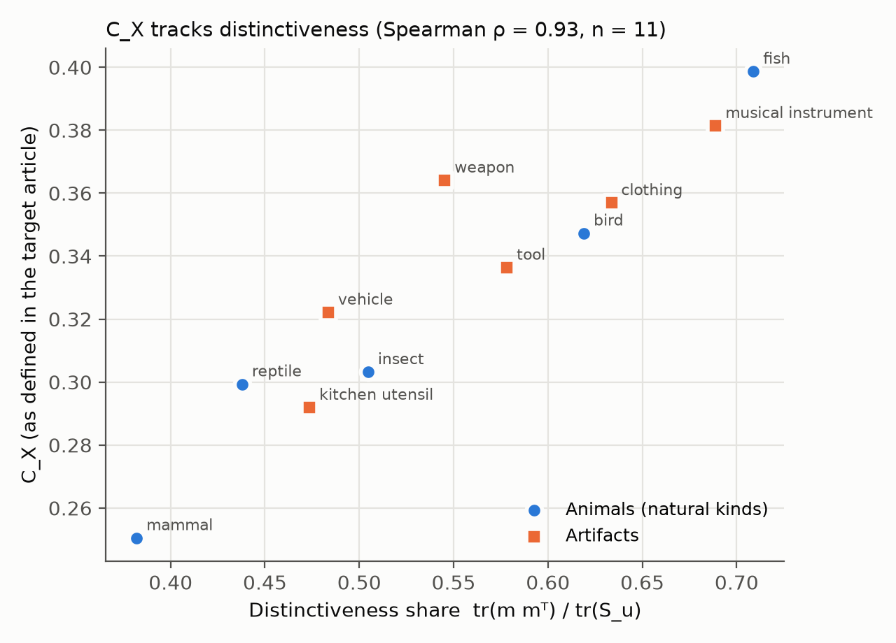
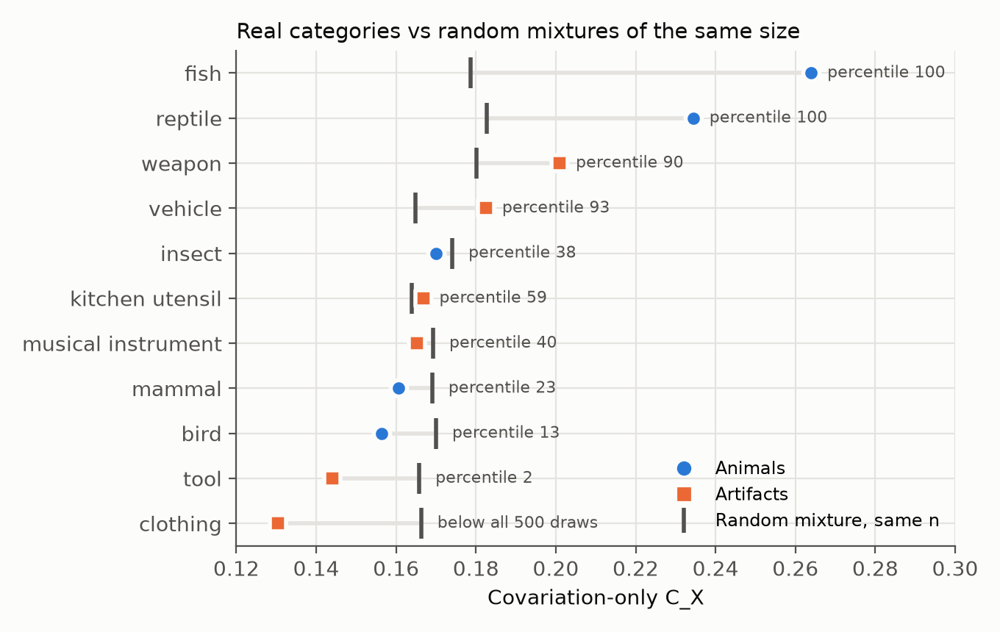
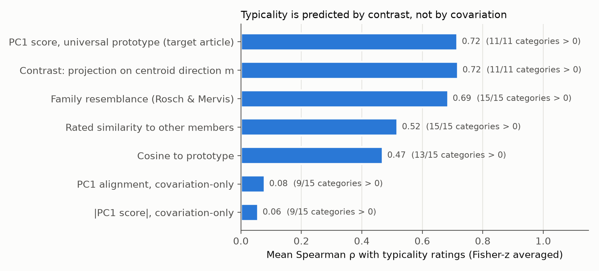

# What does C\_X measure? An empirical test of the PCA account of conceptual coherence

Nov 12, 2026 · @David Vesterlund

**David Vesterlund**, WestQuant Open, Vesterlund Ventures Holding AB, 564 91 Bankeryd, Sweden · David@vesterlundventures.se

*Comment on* Osta-Vélez, M. & Gärdenfors, P. (2026). Conceptual coherence. *Philosophy and the Mind Sciences*, 7.

**Abstract.** Osta-Vélez and Gärdenfors propose that a concept's coherence is the efficiency with which its features can be compressed, and they define a measure, C\_X, from a salience-weighted PCA taken around a universal prototype. The measure is not computed on data in the target article. I compute it exactly as defined on the Leuven Natural Concept Database (15 categories, exemplar-by-feature applicability matrices, human feature-importance, typicality and similarity ratings) and replicate on the McRae et al. (2005) norms and in two sentence-embedding spaces. Centring on the universal prototype adds a rank-one distinctiveness term to the matrix, and in every data set C\_X is dominated by it (Spearman ρ = 0.83–0.94 with the distinctiveness share). C\_X does not separate natural kinds from artifacts in any of twelve variants (all p ≥ 0.21), although human similarity ratings do (p = 0.004). Its first principal component predicts typicality well (mean ρ = 0.72) only because it points at the category centroid; it is rank-equivalent to a simple contrast model (ρ = 0.99). The covariation-only part of the measure predicts no typicality, and several core categories (bird, mammal, tool, clothing) show no more feature covariation than random same-size mixtures. I suggest separating the two components explicitly: what the measure gets right is a contrast or caricature effect, not compressibility.

## 1 Introduction

The target article turns an old intuition into a formula. A concept is coherent to the extent that its properties covary, so that its exemplars can be summarised by few dimensions; *dog* is coherent, *things to save from a fire* is not. Using conceptual spaces and principal component analysis, the authors define a coherence score C\_X and argue that it explains why natural kinds are more coherent than artifacts, why superordinates are less coherent than their subordinates, why coherent concepts support stronger induction, and why typical exemplars are those aligned with a concept's main covariation pattern (their reanalysis of Rehder's causal-coherence results).

The proposal is attractive because it is precise enough to compute, yet the article does not compute it. This comment does. Section 2 makes one analytic observation about the measure's reference point. Sections 3–5 compute C\_X on human feature norms and in language-model embedding spaces and test the article's main predictions against human data. Section 6 argues that the part of C\_X that works is a contrast effect rather than compressibility, and proposes how the framework could separate the two.

I focus on the measure as stated in Section 3.3 of the target article, not on the broader theory of conceptual spaces, which these results leave untouched.

## 2 An analytic observation: the universal prototype adds a distinctiveness term

The target article rejects standardisation and centres the salience-weighted data on a universal prototype u, the mean of all objects, rather than on the concept's own mean. With exemplars x\_k, salience weights s and ȳ the concept mean, the matrix whose eigenvalues define C\_X is a second-moment matrix, and it decomposes exactly:

```math
S_u = \frac{1}{n}\sum_{k}\big(s\odot(x_k-u)\big)\big(s\odot(x_k-u)\big)^{\top} = \mathrm{Cov}_s(X) + m\,m^{\top}, \qquad m = s\odot(\bar{x}-u)
```

The first term is the salience-weighted covariance, which carries the covariation the theory is about. The second is a rank-one term that grows with the squared distance between the concept and the universal prototype. When that distance is large relative to the concept's internal spread, m mᵀ dominates the first eigenvalue, the first principal component points from u towards the concept centroid, and C\_X is high whether or not any features covary. I call tr(m mᵀ)/tr(S\_u) the *distinctiveness share*.

The effect is easy to show with synthetic data (30 exemplars, 20 dimensions, r = 0.5):

| Synthetic concept | C\_X (target article) | C\_X (own mean) | Distinctiveness share |
| --- | --- | --- | --- |
| No covariation, near u | 0.126 | 0.125 | 0.04 |
| No covariation, far from u | 0.478 | 0.131 | 0.95 |
| Strong one-factor covariation, near u | 0.456 | 0.456 | 0.05 |
| Strong one-factor covariation, far from u | 0.497 | 0.456 | 0.94 |

A concept with no feature covariation but a distant location scores as high as one whose features are driven by a single latent factor. The authors anticipate part of this when they note that animal concepts such as *tiger* show "little or no direct correlation between their dimensions, yet their overall covariance structure remains stable when measured against the universal prototype" (§3.3). The decomposition shows what that stability is: distance from u, not covariation. Whether this is a flaw depends on what C\_X is meant to capture. The rest of this comment asks which of the two components accounts for the empirical phenomena the article lists.

## 3 Data and implementation

**Leuven Natural Concept Database** (De Deyne et al., 2008). Fifteen categories with 20–33 exemplars each: five animal categories (bird, fish, insect, mammal, reptile), six artifact categories (clothing, kitchen utensil, musical instrument, tool, vehicle, weapon), and fruit, vegetable, profession and sport. For every exemplar and every feature generated for its category, four raters judged whether the feature applies (0–4). Two domain matrices give all 129 animals and all 166 artifacts on a common feature set. The database also provides human ratings of feature importance (−3 to 3), exemplar typicality, and pairwise similarity within each category. This makes it unusually well suited to the target article: the conceptual space has explicit dimensions, and salience weights can be taken from human ratings rather than chosen by the modeller.

**McRae et al. (2005)** feature production norms (541 concepts, 2,526 features) serve as a replication. Category membership was taken from taxonomic features (*a\_bird*, *a\_tool*, and so on), yielding ten categories with 10–42 members.

**Implementation.** C\_X follows §3.3 of the target article: salience = mean importance rating rescaled linearly to \[0, 1\]; the matrix is taken around the universal prototype; p\_i = λ\_i / Σλ\_j; C\_X = Σ w\_i p\_i with w\_i ∝ (1 − r) r^(i−1), r = 0.5 (robustness checked for r = 0.3, 0.7, 0.9). Since animals and artifacts have different feature sets, the universal prototype is the mean of the relevant domain (129 or 166 exemplars). The covariation-only comparison uses the same weights centred on the concept's own mean, which is standard weighted PCA. Two operational choices matter for fairness. First, the domain matrices are used throughout, so one rater group judged every exemplar entering a given C\_X. Second, because C\_X depends on the number of exemplars, size-matched variants (repeated subsampling to n = 20) and size-matched random baselines (500 random draws of the same size from the same domain) are reported.

**Tests.** Natural-versus-artifact differences use exact permutation tests over all 462 splits of the 11 domain categories. Category-level associations use Spearman correlations. Typicality analyses correlate exemplar-level predictors with mean typicality ratings within each category and average the coefficients via Fisher's z.

## 4 Results with human norm data

### 4.1 C\_X tracks distinctiveness

Across the 11 domain categories, C\_X correlates with the distinctiveness share at ρ = 0.93 (p < 0.001; Figure 1). The correlation holds for every r tested (ρ = 0.84–0.94) and replicates in McRae's norms (ρ = 0.94, n = 10). The covariation-only variant correlates with the distinctiveness share at ρ = 0.21. In every category the first principal component of S\_u is nearly parallel to m (mean |cos| = 0.996). Fish and musical instruments receive the highest C\_X because they lie furthest from their domain's prototype, not because their features covary more.



*Figure 1.* Target-article C\_X against the distinctiveness share tr(m mᵀ)/tr(S\_u), 11 Leuven domain categories.

### 4.2 Natural kinds versus artifacts

The article's central prediction fails in every variant: C\_X does not separate the five animal categories from the six artifact categories. Human similarity ratings do.

| Measure (mean over categories) | Animals | Artifacts | Permutation p |
| --- | --- | --- | --- |
| C\_X, target article | 0.320 | 0.342 | 0.43 |
| C\_X, covariation-only | 0.203 | 0.188 | 0.51 |
| C\_X, target article, size-matched (n = 20) | 0.324 | 0.347 | 0.39 |
| Family resemblance (mean pairwise cosine) | 0.799 | 0.750 | 0.12 |
| Rated within-category similarity | 0.449 | 0.302 | 0.004 |

No variant across salience weighting, reference point, feature space, size matching and r has p below 0.21. In McRae's norms the covariation-only variant points the wrong way (animals 0.124, artifacts 0.167, p = 0.14).

### 4.3 Superordinates and random baselines

The superordinate prediction holds on its face. C\_X for *animal* (0.145) is lower than for each of its five subcategories, and C\_X for *artifact* (0.138) is lower than for each of its six. Two controls qualify this. A random sample of 26 animals (the median category size) scores 0.174 on average, higher than the full domain of 129, so part of the effect is sample size. More importantly, every real category beats size-matched random mixtures under the target-article definition, but random mixtures sit at the domain prototype by construction, so this comparison again rewards distinctiveness. Under the covariation-only definition, only fish and reptile clearly exceed random mixtures (100th percentile), vehicle and weapon come close (93rd and 90th), and bird (13th), mammal (23rd), tool (2nd) and clothing (below all 500 draws) show *less* feature covariation than random collections of animals or artifacts (Figure 2). If coherence is compressibility, several paradigmatic categories are not coherent.



*Figure 2.* Covariation-only C\_X for each real category (dots) against the mean of 500 random same-size mixtures from the same domain (bars); labels give the real category's percentile in that null distribution.

### 4.4 Rated within-category similarity

The database has no direct coherence ratings. The closest human measure is the mean rated similarity between members of a category, which tracks how much a category is perceived to hang together. The target-article C\_X is unrelated to it, whereas the covariation-only variant shows a moderate, uncertain association:

| Measure | Spearman ρ | p | n |
| --- | --- | --- | --- |
| C\_X, target article | −0.12 | 0.73 | 11 |
| C\_X, covariation-only | 0.42 | 0.20 | 11 |
| C\_X, covariation-only, unweighted, all categories | 0.52 | 0.048 | 15 |
| Family resemblance | 0.22 | 0.43 | 15 |

The covariation-only association survives partialling out family resemblance (partial r = 0.47, p = 0.08, n = 15) and holds across r (ρ = 0.42–0.56), while the target-article variant stays between −0.21 and 0.01. With 11–15 categories this is suggestive at best, but it points in an interesting direction: the component the article's argument is about may carry some signal, and the reference point chosen to define the measure suppresses it.

### 4.5 Typicality

The target article suggests that typical exemplars align with a concept's main covariation pattern. Within each category, I correlated typicality ratings with exemplar scores on the first principal component and with standard baselines (Figure 3).

| Predictor | Mean ρ | Categories with ρ > 0 |
| --- | --- | --- |
| PC1 score, universal prototype (target article) | 0.72 | 11/11 |
| Contrast: projection on m | 0.72 | 11/11 |
| Family resemblance (Rosch & Mervis, 1975) | 0.69 | 15/15 |
| Cosine to the category prototype | 0.47 | 13/15 |
| PC1 alignment, covariation-only | 0.08 | 9/15 |

The target-article PC1 predicts typicality well, but within categories it is rank-equivalent to the contrast projection (mean ρ = 0.99 between them). Exemplars rated typical are those that lie furthest from the universal prototype in the direction of their category: they are caricatures of the category relative to its domain, in the sense of Ameel and Storms (2006). The covariation-only first component, which is what "aligned with the main covariation pattern" means if covariation is taken literally, predicts essentially nothing.



*Figure 3.* Mean within-category Spearman correlation between each predictor and typicality ratings. The target-article PC1 and the contrast projection are only available for the 11 domain categories.

## 5 Replication in sentence-embedding spaces

Conceptual spaces need not be built from feature norms. A natural alternative is the geometry learned by language models, so I embedded all 415 exemplar names with two independent sentence encoders, all-MiniLM-L6-v2 (Reimers & Gurevych, 2019; Wang et al., 2020) and bge-small-en-v1.5 (Xiao et al., 2023), each with two input templates ("robin" and "a robin"). This space also allows a true universal prototype, the mean of all 415 exemplars across all 15 categories.

| Result | MiniLM | BGE-small |
| --- | --- | --- |
| C\_X vs distinctiveness share, ρ | 0.83–0.84 | 0.84–0.88 |
| Natural vs artifact, C\_X (target article), p | 0.50–0.72 | 0.59–0.95 |
| C\_X (target article) vs rated within-category similarity, ρ | 0.18–0.56 | 0.03–0.26 |
| Typicality, PC1 score (target article), mean ρ | 0.39–0.40 | 0.37–0.40 |
| Typicality, contrast projection, mean ρ | 0.37–0.41 | 0.38–0.40 |
| Typicality, cosine to category label, mean ρ | 0.41–0.43 | 0.40–0.44 |
| Typicality, covariation-only PC1, mean ρ | 0.01–0.03 | −0.09 to −0.02 |
| Pairwise similarity: embedding vs features, mean ρ with human ratings | 0.26–0.30 vs 0.65 | 0.24–0.29 vs 0.65 |

Ranges span the two templates. The pattern from Section 4 replicates in a space built without any human feature listing. C\_X again tracks distinctiveness, again fails to separate natural kinds from artifacts, and again predicts typicality only through its contrast component, which is matched by the even simpler cosine between an exemplar and its category label. One difference is worth noting. In embedding space, more real categories exceed size-matched random mixtures on covariation-only C\_X (5–10 of 15 above the 95th percentile), presumably because co-occurrence statistics give category members shared directions that verbal feature lists do not. Embedding geometry is, however, a markedly worse model of human similarity than the Leuven features: the feature space predicts pairwise similarity ratings better in all 15 categories for both models and templates.

## 6 Discussion: what survives, and a constructive proposal

The results separate two ideas that the target article fuses. The first is **compressibility**: a coherent concept is one whose internal variation lies along few axes. The second is **contrast**: a coherent concept is one that stands far from everything else in its domain, so that its members share what distinguishes them. Through the universal prototype, C\_X measures mostly the second. That component does real explanatory work: it predicts typicality as well as Rosch and Mervis's family resemblance, and it yields the superordinate effect. But it is an old idea, close to cue validity and to caricature models of typicality (Ameel & Storms, 2006), and it does not need PCA. The first component, which the article's argument is about, does not predict typicality, does not separate natural kinds from artifacts, and leaves several paradigmatic categories no more compressible than random collections.

Three caveats limit these conclusions. Verbal feature norms are not the continuous quality dimensions of conceptual spaces; colour, size and shape enter only as listed features. The comparison with human data uses rated within-category similarity rather than direct coherence judgements, and with 11–15 categories the category-level tests have little power. Finally, the universal prototype is the domain mean, not the mean of all things; widening it would, by the decomposition in Section 2, strengthen rather than weaken the distinctiveness effect.

The framework can absorb these results if it makes the two components explicit. I propose three steps.

1. **Report both components.** Define coherence on Cov\_s(X) around the concept's own mean, and treat distinctiveness, ‖m‖² or the distinctiveness share, as a separate quantity. The theory can then say which phenomena each explains, and the reference point stops doing hidden work.
2. **Specify the space before measuring.** The natural-kind advantage, if it is a covariation effect, should appear where the space has the dimensions in which natural kinds are thought to cohere: perceptual and causal ones. The Leuven importance ratings show that human salience weights do not produce it. Saying which dimensions should produce it would turn the claim into a testable one.
3. **Test on categories that vary in coherence.** Vernacular categories are all fairly coherent. Ad hoc and goal-derived categories (Barsalou, 1983) and random mixtures, built as subsets of exemplars with known feature profiles, would give the measure the range it needs. Direct coherence and induction-strength ratings for such sets are the decisive test, and the data used here would allow C\_X to be computed for them without new feature norms.

None of this undermines the larger aim of the target article. Giving coherence a formal definition is what made it possible to discover that the definition measures something other than intended. The comment is offered in that spirit.

## Data and code availability

All analyses use public data: the Leuven Natural Concept Database (cleaned English-label copy at [github.com/mikulatomas/dutch-concepts](https://github.com/mikulatomas/dutch-concepts)) and the McRae et al. (2005) norms. Analysis code and supplied results, with fixed random seeds, are available at [github.com/VesterlundCoder/cx_measure](https://github.com/VesterlundCoder/cx_measure). See the repository's [provenance notes](PROVENANCE.md) for the scope of independent verification and differences between the included analyses.

## Acknowledgments

The analysis code and a first draft of this text were developed with the assistance of Claude (Anthropic). The author checked all computations and is responsible for the content.

## References

- Ameel, E., & Storms, G. (2006). From prototypes to caricatures: Geometrical models for concept typicality. *Journal of Memory and Language*, 55, 402–421.
- Barsalou, L. W. (1983). Ad hoc categories. *Memory & Cognition*, 11, 211–227.
- De Deyne, S., Verheyen, S., Ameel, E., Vanpaemel, W., Dry, M. J., Voorspoels, W., & Storms, G. (2008). Exemplar by feature applicability matrices and other Dutch normative data for semantic concepts. *Behavior Research Methods*, 40, 1030–1048. [doi:10.3758/BRM.40.4.1030](https://www.doi.org/10.3758/BRM.40.4.1030)
- McRae, K., Cree, G. S., Seidenberg, M. S., & McNorgan, C. (2005). Semantic feature production norms for a large set of living and nonliving things. *Behavior Research Methods*, 37, 547–559. [doi:10.3758/BF03192726](https://www.doi.org/10.3758/BF03192726)
- Osta-Vélez, M., & Gärdenfors, P. (2026). Conceptual coherence. *Philosophy and the Mind Sciences*, 7. [doi:10.33735/phimisci.2026.12377](https://doi.org/10.33735/phimisci.2026.12377)
- Reimers, N., & Gurevych, I. (2019). Sentence-BERT: Sentence embeddings using Siamese BERT-networks. In *Proceedings of EMNLP-IJCNLP 2019* (pp. 3982–3992).
- Rosch, E., & Mervis, C. B. (1975). Family resemblances: Studies in the internal structure of categories. *Cognitive Psychology*, 7, 573–605.
- Wang, W., Wei, F., Dong, L., Bao, H., Yang, N., & Zhou, M. (2020). MiniLM: Deep self-attention distillation for task-agnostic compression of pre-trained transformers. *Advances in Neural Information Processing Systems*, 33.
- Xiao, S., Liu, Z., Zhang, P., & Muennighoff, N. (2023). C-Pack: Packaged resources to advance general Chinese embedding. arXiv:2309.07597.
