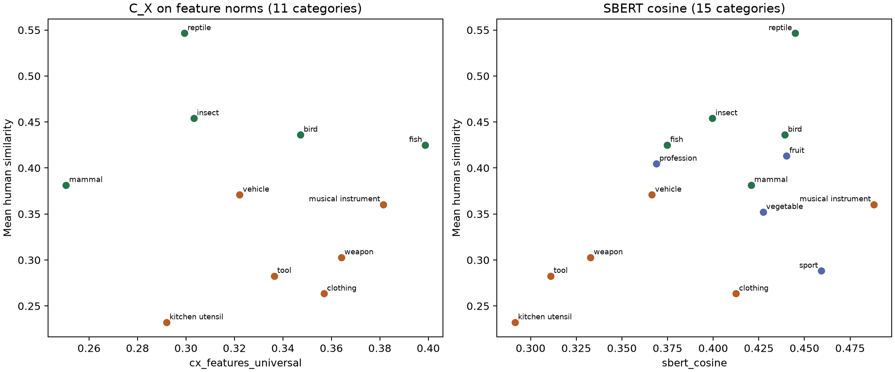
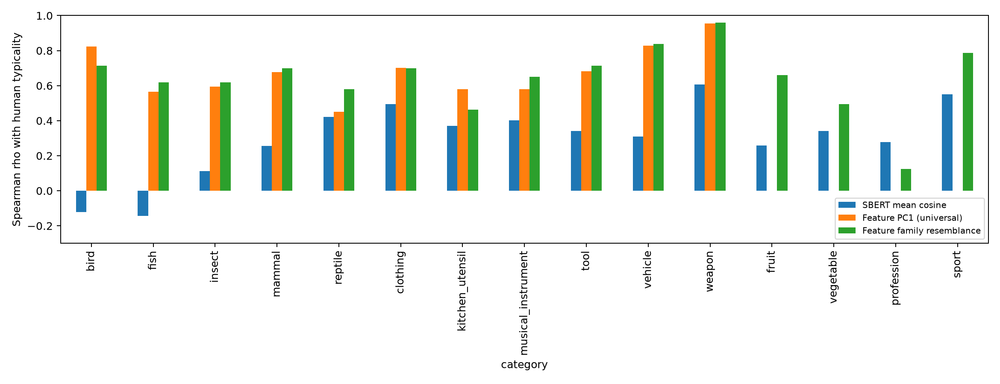

# Sentence-BERT och C_X på verkliga normdata

Kördatum: 2026-11-12. Modell: `sentence-transformers/all-mpnet-base-v2`, revision `e8c3b32edf5434bc2275fc9bab85f82640a19130`.

## Vad som faktiskt jämförs

Grundartikeln, Osta-Vélez & Gärdenfors (2026), *Conceptual coherence*,
definierar C_X men redovisar inga numeriska Leuven-resultat. Referensresultaten
kommer från den bifogade normdataanalysen, inte från författarnas egen
empiriska utvärdering. Här har dess centrala Leuven-baslinjer räknats om från
rådata och verifierats mot bilagans tabeller: största absoluta avvikelse
5.08e-13.

Testet omfattar 15 kategorier, 418 kategorimedlemskap,
415 unika modellindata inklusive hela domänernas exemplar och
5723 unika par inom kategorierna. Modellens engelska namnrepresentationer
jämförs med människors likhets- och typikalitetsnormer.
Samma frysta modell används genomgående utan anpassning till normerna.

## Resultat på kategorinivå

På samma 11 kategorier är sambandet med människors bedömda likhet
ρ = 0.573 för SBERT-cosinus och
ρ = -0.118 för C_X med
universell domänprototyp på egenskapsnormerna.
Skillnaden är Δρ = 0.691, med explorativt parat
bootstrapintervall 95 % [-0.056, 1.373].
Detta intervall avser skillnaden mellan två korrelationer på samma kategorier.

| Kategorier | Mått | Spearman ρ | p (okorrigerat) |
| --- | --- | --- | --- |
| 11 | SBERT: medelcosinus | 0.573 | 0.066 |
| 11 | Egenskaper: medelcosinus | 0.255 | 0.450 |
| 11 | C_X: universell domänprototyp, salience | -0.118 | 0.729 |
| 11 | C_X: egen medelpunkt, salience, domänmatris | 0.418 | 0.201 |
| 11 | C_X: egen medelpunkt, salience, kategorimatris | 0.482 | 0.133 |
| 11 | C_X: egen medelpunkt, uniforma vikter | 0.500 | 0.117 |
| 11 | C_X på SBERT: egen medelpunkt | -0.082 | 0.811 |
| 11 | C_X på SBERT: domänprototyp | -0.045 | 0.894 |
| 11 | C_X på SBERT: global prototyp | 0.273 | 0.417 |
| 15 | SBERT: medelcosinus | 0.364 | 0.182 |
| 15 | Egenskaper: medelcosinus | 0.221 | 0.428 |
| 15 | C_X: egen medelpunkt, salience, kategorimatris | 0.450 | 0.092 |
| 15 | C_X: egen medelpunkt, uniforma vikter | 0.518 | 0.048 |
| 15 | C_X på SBERT: egen medelpunkt | -0.211 | 0.451 |
| 15 | C_X på SBERT: global prototyp | 0.021 | 0.940 |

C_X på SBERT är en separat explorativ tillämpning. Den använder uniforma
dimensionsvikter eftersom det inte finns uppmätta salience-vikter för
modellens 768 dimensioner. Global prototyp är medelvärdet av alla unika
etikettvektorer i detta begränsade urval, inte en verklig prototyp för ”sak”.
Domänrefererat C_X på SBERT korrelerar med sin avståndsandel med
ρ = 0.927.
Den direkta rangkorrelationen mellan SBERT-medelcosinus och egenskapsbaserat
C_X med universell domänprototyp är
ρ = 0.100,
p = 0.770, n = 11.

## Typikalitet

På samma 11 kategorier är Fisher-z-medel av korrelationen mot typikalitet
0.291 för SBERT-medelcosinus
och 0.716 för
bilagans signerade PC1-prediktor.
SBERT är bättre i 0 av 11 kategorier.
Medelvärdet av de parade skillnaderna i rå ρ är -0.399,
bootstrapintervall 95 % [-0.560, -0.264].

| Kategorier | Prediktor | Fisher-z-medel ρ | Aritmetiskt medel ρ | Positiva |
| --- | --- | --- | --- | --- |
| 11 | SBERT: medelcosinus till övriga | 0.291 | 0.277 | 9/11 |
| 11 | SBERT: cosinus till prototyp utan exemplaret | 0.291 | 0.277 | 9/11 |
| 11 | Egenskaper: familjelikhet | 0.724 | 0.687 | 11/11 |
| 11 | Människors medellikhet till övriga | 0.601 | 0.576 | 11/11 |
| 11 | Egenskaper: prototypcosinus | 0.440 | 0.383 | 9/11 |
| 11 | Egenskaper: signerad PC1, universell prototyp | 0.716 | 0.676 | 11/11 |
| 11 | Egenskaper: absolut PC1, universell prototyp | 0.716 | 0.676 | 11/11 |
| 11 | Egenskaper: kvadratisk PC1-anpassning | 0.578 | 0.511 | 11/11 |
| 11 | Egenskaper: kontrastprojektion | 0.718 | 0.680 | 11/11 |
| 15 | SBERT: medelcosinus till övriga | 0.311 | 0.299 | 13/15 |
| 15 | SBERT: cosinus till prototyp utan exemplaret | 0.311 | 0.299 | 13/15 |
| 15 | Egenskaper: familjelikhet | 0.686 | 0.641 | 15/15 |
| 15 | Människors medellikhet till övriga | 0.518 | 0.483 | 15/15 |
| 15 | Egenskaper: prototypcosinus | 0.423 | 0.373 | 13/15 |

I detta material ger medelcosinus till övriga och cosinus till prototypen
utan exemplaret samma rangordning, så deras Spearmankorrelationer
sammanfaller. De är närbesläktade mått, inte två oberoende bevis.
Absolut PC1-poäng och kvadratisk axelanpassning visas också, eftersom
artikelns typikalitetsdiskussion inte enbart handlar om signerade PC1-poäng.

## Parvis likhet

SBERT:s Fisher-z-medel av de 15 inomkategorikorrelationerna är
0.289; motsvarande egenskapsbaserade
cosinus ger 0.638.
SBERT har positiv korrelation i 15/15 kategorier,
och 8/15 är signifikanta efter
Holmkorrektion av tvåsidiga Manteltest.

| Kategori | n | SBERT ρ | Mantel-p | Holm-p | Egenskapscosinus ρ |
| --- | --- | --- | --- | --- | --- |
| bird | 30 | 0.074 | 0.335 | 1.000 | 0.700 |
| fish | 23 | 0.005 | 0.959 | 1.000 | 0.694 |
| insect | 26 | 0.194 | 0.011 | 0.074 | 0.588 |
| mammal | 30 | 0.359 | 0.001 | 0.007 | 0.624 |
| reptile | 20 | 0.270 | 0.011 | 0.074 | 0.766 |
| clothing | 29 | 0.443 | 0.001 | 0.007 | 0.612 |
| kitchen_utensil | 33 | 0.415 | 0.001 | 0.007 | 0.403 |
| musical_instrument | 27 | 0.289 | 0.001 | 0.007 | 0.736 |
| tool | 30 | 0.252 | 0.036 | 0.180 | 0.525 |
| vehicle | 30 | 0.484 | 0.001 | 0.007 | 0.696 |
| weapon | 20 | 0.476 | 0.001 | 0.007 | 0.690 |
| fruit | 30 | 0.070 | 0.472 | 1.000 | 0.601 |
| vegetable | 30 | 0.068 | 0.389 | 1.000 | 0.496 |
| profession | 30 | 0.398 | 0.001 | 0.007 | 0.667 |
| sport | 30 | 0.429 | 0.001 | 0.007 | 0.649 |

Varje Manteltest använder 1999 permutationer av exemplaridentiteter.
Det bevarar beroendet mellan par med gemensamma exemplar. Vanliga p-värden
med varje par som en oberoende observation skulle vara missvisande.
C_X är ett kategorimått och ger inte i sig en unik prediktion för varje par.
Parjämförelsen använder därför egenskapscosinus som baslinje.

## Natur–artefakt och överordnade kategorier

Exakt tvåsidigt permutationstest över 462 indelningar, fem djurkategorier
och sex artefaktkategorier:

| Mått | Djur | Artefakter | p |
| --- | --- | --- | --- |
| SBERT: medelcosinus | 0.416 | 0.367 | 0.197 |
| Egenskaper: medelcosinus | 0.799 | 0.750 | 0.123 |
| Människors likhet | 0.449 | 0.302 | 0.004 |
| C_X: universell domänprototyp, salience | 0.320 | 0.342 | 0.429 |
| C_X: egen medelpunkt, salience, domänmatris | 0.203 | 0.188 | 0.506 |
| C_X på SBERT: domänprototyp | 0.114 | 0.140 | 0.225 |
| C_X på SBERT: egen medelpunkt | 0.092 | 0.097 | 0.470 |

Deskriptiv jämförelse för SBERT-cosinus:

| Domän | n | Hela domänen | Lägsta underkategori | Högsta underkategori | Underkategorier över domänen |
| --- | --- | --- | --- | --- | --- |
| animal | 129 | 0.352 | 0.375 | 0.445 | 5/5 |
| artifact | 166 | 0.251 | 0.291 | 0.488 | 6/6 |

Detta mönster för cosinus är ett resultat om likhetsbaserad sammanhållning,
inte en direkt testning av C_X:s kompressionsmekanism.

## Känslighet för indataformulering

Samma modell och exemplar, med engelska namn respektive den i förväg valda
mallen `This is {label}.`. Kategorinamnet läggs inte till.

| Indata | Kategorier | ρ kategorilikhet | p | Fisher-z-medel ρ typikalitet |
| --- | --- | --- | --- | --- |
| Namn | 11 | 0.573 | 0.066 | 0.291 |
| This is … | 11 | 0.755 | 0.007 | 0.253 |
| Namn | 15 | 0.364 | 0.182 | 0.311 |
| This is … | 15 | 0.600 | 0.018 | 0.267 |

Mallen ger parvis Fisher-z-medel ρ =
0.262 och natur–artefakt-p =
0.013.
För mallen är skillnaden i kategorikorrelation mot C_X på samma 11 kategorier
Δρ = 0.873, med parat
bootstrapintervall 95 %
[0.114, 1.462].
De två formuleringarna är känslighetsanalyser av samma modell.
Ingen formulering har valts i efterhand som ”bäst”.

## Resultat per kategori, primär analys

| Kategori | n | Människolikhet | SBERT-cosinus | C_X normdata | SBERT typikalitets-ρ | PC1 typikalitets-ρ |
| --- | --- | --- | --- | --- | --- | --- |
| bird | 30 | 0.436 | 0.439 | 0.347 | -0.121 | 0.822 |
| fish | 23 | 0.425 | 0.375 | 0.399 | -0.143 | 0.564 |
| insect | 26 | 0.454 | 0.400 | 0.303 | 0.111 | 0.595 |
| mammal | 30 | 0.381 | 0.421 | 0.251 | 0.257 | 0.677 |
| reptile | 20 | 0.546 | 0.445 | 0.299 | 0.421 | 0.451 |
| clothing | 29 | 0.263 | 0.412 | 0.357 | 0.495 | 0.701 |
| kitchen_utensil | 33 | 0.232 | 0.291 | 0.292 | 0.370 | 0.579 |
| musical_instrument | 27 | 0.360 | 0.488 | 0.381 | 0.402 | 0.581 |
| tool | 30 | 0.283 | 0.311 | 0.336 | 0.342 | 0.683 |
| vehicle | 30 | 0.371 | 0.366 | 0.322 | 0.310 | 0.828 |
| weapon | 20 | 0.303 | 0.333 | 0.364 | 0.608 | 0.955 |
| fruit | 30 | 0.413 | 0.440 | — | 0.259 | — |
| vegetable | 30 | 0.352 | 0.427 | — | 0.341 | — |
| profession | 30 | 0.405 | 0.369 | — | 0.279 | — |
| sport | 30 | 0.288 | 0.459 | — | 0.550 | — |

## Hur resultaten bör tolkas

Likhet inom en kategori, typikalitet hos dess medlemmar och konceptuell
koherens är skilda mål. Ett bättre samband med likhetsbetyg räcker inte för
att etablera en bättre generell teori om koherens. Inga direkta koherensbetyg
finns i denna analys.

Jämförelsen mellan egenskapsbaserat C_X och SBERT-cosinus ändrar både
representation och mått. Egenskapscosinus och C_X på embeddings ger
kompletterande jämförelser, men isolerar inte alla metodskillnader.
11–15 utvalda kategorier ger osäkra korrelationer och bootstrapintervall.
Övriga tabellers p-värden är explorativa och okorrigerade, utom uttryckligen
Holm-korrigerade parvisa test.

Grundartikeln säger uttryckligen i avsnitt 3.3 att referensen till den
universella prototypen ska göra måttet användbart även när direkt samvariation
är låg. Att avståndstermen bidrar är därför inte i sig ett programmeringsfel
eller ett resultat som författarna uttryckligen utesluter. Det är däremot
centralt för vilken tolkning man kan ge måttet.

Deltagarna var nederländsktalande medan modellen får engelska etiketter.
Databasens etiketter bevaras exakt, inklusive flertydigheter och eventuella
nederländska parenteser. Träningsöverlapp med normdata är inte kontrollerat.
Resultaten är en jämförande pilotstudie utan träning på testbetygen, inte
ett bevis för kognitiv mekanism eller generell modellöverlägsenhet.

## Reproducerbarhet och filer

- `compare.py`: inläsning, SBERT, baslinjereplikation, statistik och figurer.
- `results/labels/` och `results/sentence/`: alla sammanfattningar och råa
  prediktioner, inklusive samtliga par, exemplarpoäng och exakta modellindata.
- `data/embeddings_*.npz`: cachade vektorer.
- `requirements.lock`: de installerade paketversionerna.
- `README.md`: körkommandon, analysval och datakällor.

Leuven-commit: `5a519d4f63318dd8bc0322b8cc00a31c30ef5146`.
Python 3.12.13, enhet `cpu`, slumpfrö 20261112.
McRae ingår endast som bevarat referensmaterial i zipbilagan; ingen ny
McRae-replikation påstås här.
